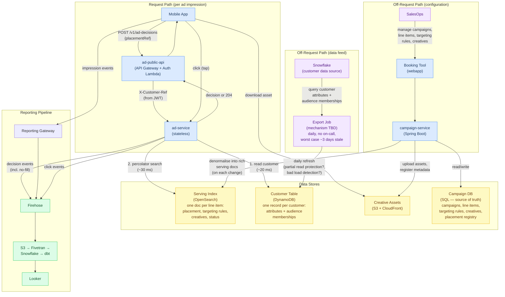

# CMP Architecture Overview

**Key:** Blue = services, Yellow = data stores, Purple = external actors, Green = reporting pipeline

---

## Findings

Observations and feedback to take back to the team.

### 1. The attribute/audience distinction is artificial

The v2 solution design treats "attributes" (age_group, gender, region) and "audiences" (interested_adidas, nike_fans) as separate concepts with different rule kinds (`"kind": "attribute"` vs `"kind": "audience"`).  In practice, audiences are just another type of attribute on the customer record: a behavioural signal computed by the Data team, rather than a demographic fact.  The serving path treats them identically; they're all values matched against targeting rules by the percolator.

Treating "attribute" as the unifying concept (with demographic and behavioural subtypes) would simplify the model and resolve much of the glossary confusion between Mindaugas, Mike, and Abhishek.  Abhishek has already asked for an agreed glossary as a root document.

### 2. Consider a single entry point into the reporting pipeline

Currently ad-service writes decision and click events directly to Firehose, while the mobile app sends impression events via the reporting gateway.  Two different routes into the same pipeline.  Routing all events (decisions, clicks, impressions) through the reporting gateway would give a single entry point with consistent schema validation, error handling, and monitoring.  The counter-argument is added latency on the request path for decision events, but that could be mitigated by making the write asynchronous (fire-and-forget to the gateway).

### 4. Customer data feed mechanism is undefined

The pipeline from Snowflake to the DynamoDB customer table has no design.  The Data team have agreed to own the table and push data daily, but the tooling, scheduling, error handling, and operational model are all TBD.  Specific gaps:

- **Tooling:** what runs the export?  A scheduled job, a Snowflake task, a Lambda, something else?
- **Partial read protection:** how does ad-service avoid reading a half-written table during a refresh?  Abhishek explicitly asked for this.
- **Bad load detection:** how is a failed or corrupt refresh detected and rolled back?
- **Staleness alerting:** who gets paged (or not) when data goes stale?  The Data team has no on-call; Tom Imperato estimated a realistic worst case of ~3 days if a Friday evening failure isn't caught until Monday.
- **Ownership sign-off:** Tom said he needs approval from Dom and Marcelo before the Data team formally accepts ownership.

---

## Delivery Status (as of 19 Nov 2026)

**In short:** the infrastructure is in place; the intelligence isn't.  The plumbing works end to end (service, gateway, CDN, reporting infra), but the bits that make it a real ad platform (targeting, click tracking, campaign management UI, data feed) are all either in flight or not started.

### Built

- **ad-service** skeleton, public API gateway with auth Lambda, `POST /v1/ad-decisions` endpoint (returning hardcoded then DynamoDB-backed ads)
- **Creative storage:** private S3 + CloudFront with OAC, immutable content-hashed keys
- **Reporting infra:** S3 reporting bucket, Firehose delivery streams, CMP reporting API gateway, front-end event contract (ready for release)
- **DynamoDB campaign-cache:** provisioned with read access for ad-service (but now being replaced)

### In progress

- **ad-service serving path** (ZILCH-57435, Jacek): being reworked to drop DynamoDB campaign-cache and audience-service in favour of OpenSearch
- **Decision events to Firehose** (ZILCH-57307, Reeya): in PR

### Not started

- OpenSearch serving index integration (ZILCH-58385) — no assignee
- Remove campaign-cache read path (ZILCH-58386) — no assignee
- ad-service access to Data team customer table (ZILCH-58381) — no assignee
- Click endpoint and capture (ZILCH-57310)
- Mobile placement (ZILCH-57436, Ossie)
- Fivetran → Snowflake event load (ZILCH-57317, Data team)
- Booking tool webapp (ZILCH-58021)
- Customer data feed from Snowflake to DynamoDB

### Superseded

- **audience-service** epic (ZILCH-57434): rejected, replaced by Data team ownership of customer table + OpenSearch targeting

### Summary

The plumbing is in place: service, gateway, CDN, reporting infra.  The pivot from DynamoDB/in-memory ad selection to OpenSearch percolator queries is the current bottleneck.  Three unassigned tickets (58385, 58386, 58381) sit on the critical path for all targeting work.  Product has consistently ranked CMP below other Merchant priorities, which compounds the delay.

---

## Open Questions

| # | Question | Source | Notes |
|---|---|---|---|
| 1 | Glossary: "audience", "attribute", "targeting rules" mean different things to different people.  Needs a root glossary doc. | [Abhishek, thread reply 12](https://payzilch.slack.com/archives/C0A9H4JPWP8/p1794588582649729) | |
| 3 | Can a line item book multiple placements? | [Thread reply 14](https://payzilch.slack.com/archives/C0A9H4JPWP8/p1794591670797449) | Deferred to MVP. Moot for the steel thread (one placement). |
| 4 | Is creative-to-line-item assignment optional (default to campaign creatives matching format)? | [Thread replies 14-17](https://payzilch.slack.com/archives/C0A9H4JPWP8/p1794591670797449) | Deferred to MVP. Closely related to #3; both affect whether a line item is a tightly bound unit or resolves at serve time. |
| 6 | Data team ownership sign-off from Dom and Marcelo. | [Thread reply 9](https://payzilch.slack.com/archives/C0A9H4JPWP8/p1794481532862909) | Organisational, not architectural. NC's position: Data should own this. Related to the Mindaugas response task. |
| 7 | What is the mechanism for customer attribute sync (Snowflake to DynamoDB)? | [Abhishek](https://payzilch.slack.com/archives/C0A9H4JPWP8/p1794588332261499) · [Tom](https://payzilch.slack.com/archives/C0A9H4JPWP8/p1794238749357739) | Needs to address: tooling (what runs the export?), partial read protection, bad load detection/rollback, staleness alerting (Data team has no on-call; worst case ~3 days stale). Blocked by #6. |
| 10 | Customer identifier: which reference does the app send?  Table must be keyed on it. | [Tom, thread reply 1](https://payzilch.slack.com/archives/C0A9H4JPWP8/p1794238749357739) | Alignment conversation, not a design decision. Confirm Snowflake keys customers by the same value and format as the JWT customerRef. Parked behind #6; nobody's picked it up. |
| 11 | PII on the serving path (DynamoDB + OpenSearch): needs InfoSec sign-off before build. | [Tom, thread reply 1](https://payzilch.slack.com/archives/C0A9H4JPWP8/p1794238749357739) | Gate, not a design question. InfoSec hasn't been asked yet. |
| 12 | Consent: who ensures non-consenting customers are excluded from the customer table? | [Mindaugas, channel](https://payzilch.slack.com/archives/C0A9H4JPWP8/p1795004199953499) | Mike waved it away ("must be in the T&Cs"). Needs proper verification. Product should own this but Mike is Product. |
| 13 | OpenSearch decision record: document alternatives considered and tradeoffs (Abhishek's condition for approval). | [Abhishek, thread reply 12](https://payzilch.slack.com/archives/C0A9H4JPWP8/p1794588332261499) | Not a question; an open task. No Jira ticket exists. |
| 15 | How does the Data team tell campaign-service which audiences exist? (A7 in v2 doc) | | Genuine design question; no mechanism proposed. Good conversation topic. Noted against feedback task. |
| 17 | Booking tool authentication: Okta approach needs agreeing with Julien. | [Stefan sync notes](https://payzilch.slack.com/archives/C0A9H4JPWP8/p1794906097881019) | In hand between Stefan and Julien. Reminder set for 1:1 with Stefan to check status. |

## Closed Questions

| # | Question | Conclusion | Source |
|---|---|---|---|
| 2 | Are exclusion-only targeting rules valid? | Yes. "Everyone except X" is a real use case. OpenSearch needs a `match_all` base clause but that's trivial. Mindaugas accepted in the thread; v2 doc needs updating. | [Thread reply 14](https://payzilch.slack.com/archives/C0A9H4JPWP8/p1794591670797449) |
| 5 | Location tree: expand at save time or publish ancestor chains per customer? | | [Thread reply 14](https://payzilch.slack.com/archives/C0A9H4JPWP8/p1794591670797449) |
| 16 | Click endpoint: should be GET + 302 redirect, not POST. | | [Stefan sync notes](https://payzilch.slack.com/archives/C0A9H4JPWP8/p1794906097881019) |
