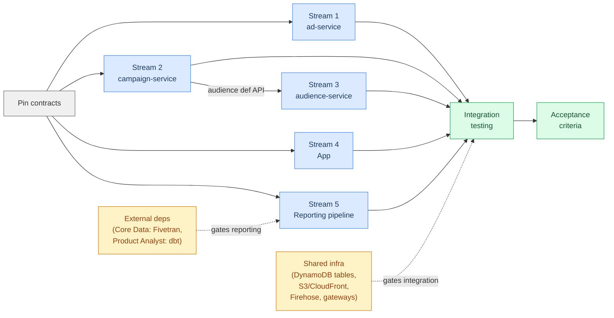

# CMP Steel Thread — Parallel Workstreams

## Contract Dependencies

Shows the five delivery streams, the agreed contracts between them, and the prerequisite/cross-cutting concerns.

```mermaid
graph TB
    subgraph contracts ["Contracts (agree first)"]
        C1["DynamoDB execution store shape<br/><i>ST2 §2</i>"]
        C2["DynamoDB audience cache shape<br/><i>ST2 §1</i>"]
        C3["POST /v1/ad-decisions<br/>request + response<br/><i>ST1 §2</i>"]
        C4["Decision event schema<br/><i>ST4 §2.1</i>"]
        C5["Front-end event schema<br/><i>ST4 §2.2</i>"]
        C6["Click redirect contract<br/><i>ST4 §5</i>"]
        C7["S3 key layout + CDN URL<br/><i>ST1 §3–4</i>"]
        C8["Audience definition<br/>read API<br/><i>ST3 §4.1</i>"]
    end

    subgraph s1 ["Stream 1: ad-service"]
        S1A["Selection logic"]
        S1B["ad-public-api gateway"]
        S1C["Click redirect endpoint"]
        S1D["Firehose event emission"]
    end

    subgraph s2 ["Stream 2: campaign-service"]
        S2A["Relational data model"]
        S2B["Management CRUD API"]
        S2C["Write-through → DynamoDB"]
        S2D["Placement registry migration"]
        S2E["Audience definition API"]
    end

    subgraph s3 ["Stream 3: audience-service"]
        S3A["Snowflake query engine"]
        S3B["Audience cache writer"]
        S3C["Scheduled refresh"]
    end

    subgraph s4 ["Stream 4: App"]
        S4A["Placement component"]
        S4B["Ad-decision request"]
        S4C["Impression event emission"]
        S4D["Tap-through + fallback"]
        S4E["Feature-flagged rollout"]
    end

    subgraph s5 ["Stream 5: Reporting pipeline"]
        S5A["Firehose delivery streams"]
        S5B["Fivetran → Snowflake"]
        S5C["dbt models<br/>(join, dedup, quality)"]
        S5D["Looker dashboards"]
    end

    C1 --> S1A
    C1 --> S2C
    C2 --> S1A
    C2 --> S3B
    C3 --> S1A
    C3 --> S4B
    C4 --> S1D
    C4 --> S5C
    C5 --> S4C
    C5 --> S5C
    C6 --> S1C
    C6 --> S4D
    C7 --> S2B
    C7 --> S4A
    C8 --> S2E
    C8 --> S3A

    S2E -.->|"hard dependency"| S3A

    classDef contractStyle fill:#f0f0f0,stroke:#666,color:#333
    classDef stream1 fill:#dbeafe,stroke:#3b82f6,color:#1e3a5f
    classDef stream2 fill:#dcfce7,stroke:#22c55e,color:#14532d
    classDef stream3 fill:#fef9c3,stroke:#eab308,color:#713f12
    classDef stream4 fill:#fce7f3,stroke:#ec4899,color:#831843
    classDef stream5 fill:#f3e8ff,stroke:#a855f7,color:#581c87

    class C1,C2,C3,C4,C5,C6,C7,C8 contractStyle
    class S1A,S1B,S1C,S1D stream1
    class S2A,S2B,S2C,S2D,S2E stream2
    class S3A,S3B,S3C stream3
    class S4A,S4B,S4C,S4D,S4E stream4
    class S5A,S5B,S5C,S5D stream5
```

## Dependency & Sequencing View

Shows what blocks what, and where streams can proceed independently.

## Contract Matrix

Which stream produces and consumes each contract.

| Contract | Producer | Consumer(s) |
|---|---|---|
| DynamoDB execution store shape | campaign-service (writer) | ad-service (reader) |
| DynamoDB audience cache shape | audience-service (writer) | ad-service (reader) |
| `POST /v1/ad-decisions` | ad-service | App |
| Decision event schema | ad-service | Reporting pipeline |
| Front-end event schema | App | Reporting pipeline |
| Click redirect | ad-service | App |
| S3 key layout / CDN URL | campaign-service (metadata) | App (asset download) |
| Audience definition read API | campaign-service | audience-service |
